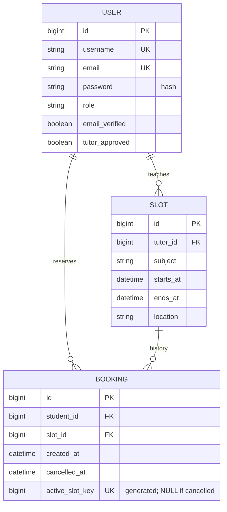

# Database tier: MySQL

This directory explains and bootstraps database access. It is not a separate application server. MySQL runs independently; Django connects using environment variables. Business tables are created from versioned migrations in backend/reservations/migrations/.



Equivalent essential uniqueness mechanism:

```sql
active_slot_key BIGINT GENERATED ALWAYS AS
  (CASE WHEN cancelled_at IS NULL THEN slot_id ELSE NULL END) STORED,
UNIQUE (active_slot_key)
```

Do not manually duplicate this DDL after running migrations. Inspect the real migration SQL using:

```bash
python manage.py sqlmigrate reservations 0001
```

All scheduling tables must use InnoDB. The configured bootstrap database collation is utf8mb4_unicode_ci, making email uniqueness case-insensitive. Serializer normalization also lowercases emails. A check requires end time greater than start time. Foreign keys preserve references; role appropriateness and schedule overlaps are enforced by services.

Cancellation updates cancelled_at, causing MySQL to automatically set active_slot_key to NULL. Multiple cancelled bookings remain for history without blocking a new active reservation.

The isolated local test/preview instance lives under the ignored .runtime/ directory and uses a local Unix socket without a network listener. It is not included in archives and is not your existing MySQL instance. A fresh checkout should follow bootstrap.sql and SETUP.md rather than expecting that private instance to exist.
